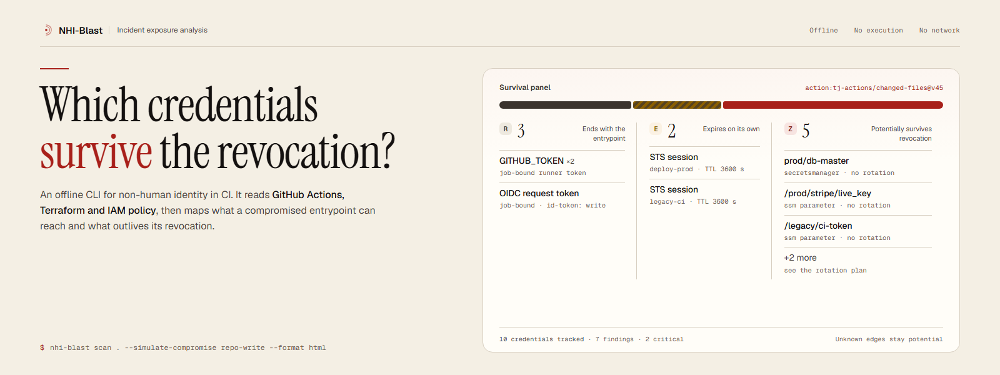
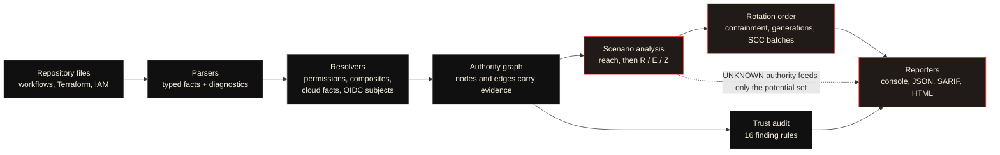
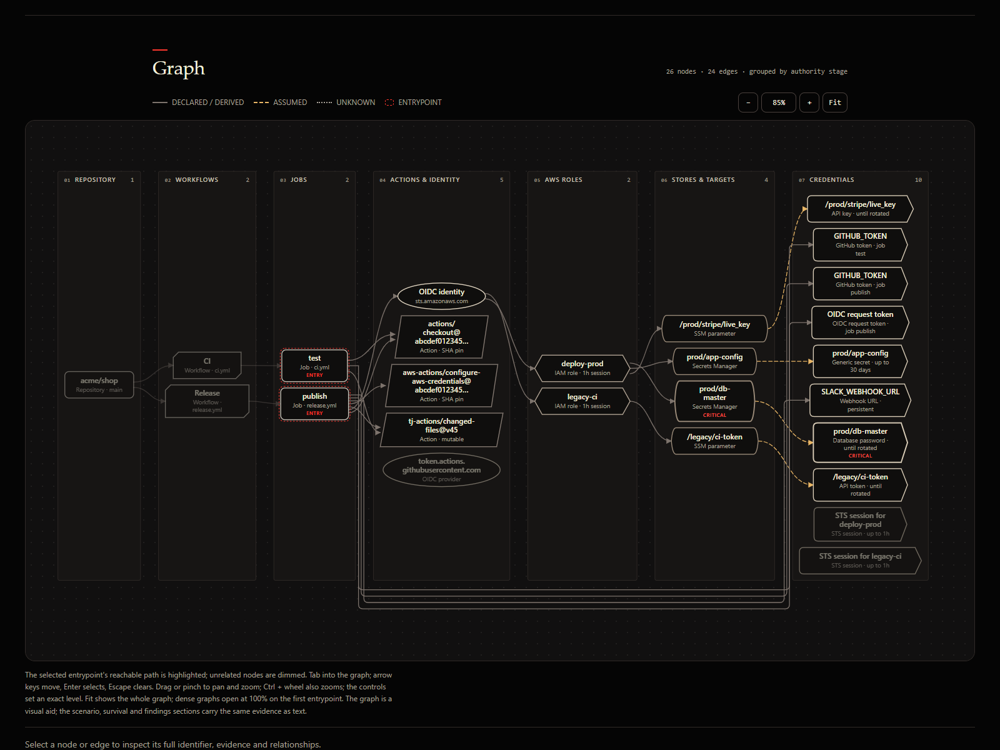

<p align="center">
  <picture>
    <source media="(prefers-color-scheme: dark)" srcset="assets/readme/banner-dark.png">
    
  </picture>
</p>

<p align="center">
  <a href="https://github.com/DKtech-dev/nhi-blast/actions/workflows/ci.yml"></a>
  
  
</p>

<p align="center">
  <strong>Offline blast-radius analysis for non-human identity in CI.</strong><br>
  GitHub Actions, Terraform and IAM policy in. Reach, revocation survival and rotation order out —
  with no execution, no network and no credential values.
</p>

> **Release status.** [`v0.1.1`](https://github.com/DKtech-dev/nhi-blast/releases/tag/v0.1.1) is the
> latest published release; both published releases were distributed under the MIT License. The
> source tree on `main` is version `0.2.0` under a [proprietary licence](LICENSE), and no 0.2.0
> artifact is published. No independent audit has been performed or is claimed.

## The problem

When a CI entrypoint is revoked — a mutable third-party action, a leaked secret, a repository
writer — some credentials end with the job, some expire on their own, and some survive. Working out
which is which from workflow YAML, Terraform state and IAM policies by hand is slow and easy to get
wrong, and live cloud calls are often unavailable during an incident.

NHI-Blast reconstructs the authority those files describe, offline, and answers three questions:

| | Question | Result |
| --- | --- | --- |
| **01** | **Reach** | Which AWS roles, credential stores and credentials are potentially reachable from a mutable action, a job, a leaked secret or a repository writer? |
| **02** | **Revocation survival** | If that entrypoint is revoked now, which credentials end with the job (**R**), which temporary sessions expire on their own (**E**), and which persistent credentials survive (**Z**)? |
| **03** | **Rotation order** | In what order should surviving credentials be rotated so a surviving credential cannot re-read a freshly rotated one? |

<p align="center">
  
</p>

<p align="center">
  <sub>The offline HTML report from the synthetic <code>fx07-incident</code> fixture: summary and
  R/E/Z survival panel, with the rotation plan, authority graph, findings and evidence detail
  further down the same file. Values are synthetic. One file, no network requests; repository
  strings render inert.</sub>
</p>

## How it works

NHI-Blast is a single-process pipeline. Discovery walks the scan root and refuses paths outside it.
Pure parsers turn each input into typed facts and diagnostics without executing Terraform, Git,
shell or GitHub expressions. Resolvers expand local composites, compute effective permissions,
normalise cloud resources and derive candidate OIDC subjects from the trigger profile. One graph
builder merges those facts into an authority graph, and every node and edge carries evidence. A
scenario selects an entrypoint, finds best-evidence paths, partitions credentials into R/E/Z and
orders survivors for rotation. Every reporter serialises the same validated report model.



The graph is deterministic and computed in Python; the HTML renderer inlines the same geometry used
on screen and in print. UNKNOWN-class edges never enter R, E or Z. The full layer map, import
boundaries and graph rules are in [architecture](docs/architecture.md).

<p align="center">
  
</p>

<p align="center">
  <sub>The same report's authority graph, grouped by authority stage. Line style encodes evidence
  class; the selected entrypoint and its reachable path are highlighted. The graph is a visual aid —
  survival, findings and evidence carry the same information as text.</sub>
</p>

## What it reads

| Input | Modelled |
| --- | --- |
| GitHub Actions workflows | Triggers, jobs, steps, permissions, secret references and OIDC use |
| Local composite actions and reusable workflows | Inputs, steps and call sites expanded in place, with caller provenance |
| Terraform plan/state JSON | Roles, policies, trust relationships, credential stores and rotation resources |
| Terraform `.tf.json` (HCL fallback) | Static configuration when a plan is unavailable; best-effort and labelled as such |
| IAM policy JSON | Allow/deny statements, conditions and assume-role trust relationships |

Remote reusable workflows are modelled on the caller grant only. Expression-based references are not
evaluated; they remain UNKNOWN and produce diagnostics. See [known limitations](docs/known-limitations.md).

## Evidence, not verdicts

Every node and edge carries at least one evidence record. The classes are ordered:

`DECLARED` > `DERIVED` > `ASSUMED` > `UNKNOWN`

An edge's confidence is the weakest class among its evidence. UNKNOWN-class edges never count as
reachable authority; they feed a separate `potential` set. A finding states what the files support,
not that a compromise occurred — an assume-role result means "accepted by the trust policy as
written", not that a path was exercised.

| Class | Meaning |
| --- | --- |
| `DECLARED` | Stated by the input: a workflow permission, a trust policy, an IAM statement |
| `DERIVED` | Inferred by a documented platform rule from declared facts |
| `ASSUMED` | Depends on an `A-*` assumption or `H-*` heuristic listed in the report and [assumptions](docs/assumptions.md) |
| `UNKNOWN` | Unresolved; contributes only to `potential`, never to R, E or Z |

## Install from a source checkout

Requires **Python 3.12+** (tested on 3.12, 3.13 and 3.14). Version 0.2.0 is a source-tree version;
no package is published. The tool itself needs no cloud credentials and makes no network requests
while scanning.

```
python -m venv .venv
.venv/bin/python -m pip install ".[hcl]"
```

On Windows use `.venv\Scripts\python.exe`. The `hcl` extra enables the optional Terraform HCL
fallback. `rich` is an optional console-rendering extra; the CLI works without it. For development,
install `".[dev,hcl]"` instead.

Activate the environment (`.venv/bin/activate`, or `.venv\Scripts\activate` on Windows), then confirm
the installation:

```
nhi-blast version --data
```

For exact dependency versions, add `-c requirements.lock` to the install command. The tool runs
offline, but installing it needs access to a package index or a local wheelhouse.

## Quickstart

Scan the reference fixture and run its incident scenario:

```
nhi-blast scan tests/fixtures/fx07-incident \
  --simulate-compromise action:tj-actions/changed-files@v45 \
  --format console \
  --format html \
  --fail-on high \
  --out nhi-blast-out
```

`--format` is repeatable; comma-separated values are rejected. The command prints the console
summary and writes `report.html` to `--out`. It exits `1` when a finding meets the `--fail-on`
threshold, so this example exits `1` by design.

A trimmed console result from that run:

```text
Survival
  action:tj-actions/changed-files@v45
  R (ends with entrypoint): 3
  E (expires on its own): 2
  Z (survives): 5
    Z prod/db-master (cred:aws:secret:prod/db-master:stored) [declared tfstate.json:77]; depth 0; until rotated; criticality 100

Rotation plan
  action:tj-actions/changed-files@v45 - Rotation
  step 1 generation 0:
    prod/db-master: Rotate the database master password, update the credential store, then terminate
    existing database sessions so the old password cannot be reused. [declared tfstate.json:77]

Findings
  [CRITICAL] NHB-OIDC-002 NHB-OIDC-002-ebd9705d: Organisation-wide or global wildcard in sub
  [CRITICAL] NHB-SURV-001 NHB-SURV-001-4b5ea811: Credentials survive revocation of the entrypoint
```

The counts are the scenario partition. Each credential line names the credential, its graph id, the
weakest evidence class that supports the path and the source location. The rotation step is
ordered after containment; findings are severity-labelled statements about the files, not a claim
that a compromise occurred. JSON, SARIF and HTML carry the full graph, evidence and assumptions.

Typical use against your own checkout:

```
nhi-blast scan . --simulate-compromise repo-write --fail-on high
nhi-blast rank .
nhi-blast export . --format dot --out nhi-blast-out
nhi-blast explain NHB-OIDC-002-ebd9705d --report nhi-blast-out/report.json
```

A scan with no `--simulate-compromise` selector still builds the graph, audits OIDC trust and reports
findings, but runs no survival scenario.

## Commands

| Command | Purpose | Artifacts |
| --- | --- | --- |
| `scan PATH` | Parse, audit trust, run scenarios, emit findings | `report.json`, `report.sarif`, `report.html` depending on `--format` |
| `rank PATH` | Rank mutable third-party actions by potential blast radius | `rank.json` with `--format json` |
| `explain ID --report FILE` | Print the evidence chain for a finding, node or edge | none |
| `export PATH --format json\|dot` | Export the authority graph | `graph.json` or `graph.dot` |
| `schema` | Print the report JSON Schema to stdout | none |
| `version [--data]` | Print tool, schema and data-file versions and ages | none |

Exit codes: `0` success, `1` findings at or above `--fail-on`, `2` usage or input error, `3` partial
results when error diagnostics exist and `--strict` is set, `4` unexpected internal error.

Common options include `--tf-json`, `--tf-hcl/--no-tf-hcl`, `--iam-json`, `--repo-slug`,
`--default-branch`, `--aws-account`, `--aws-region`, `--config`, `--max-depth`, `--strict`,
`--timestamp` and `--no-color`. Run `nhi-blast <command> --help` for the exact surface.

## Compromise selectors

| Selector | Meaning |
| --- | --- |
| `action:OWNER/REPO[/PATH]@REF` | A mutable third-party action at a specific reference, at all of its use sites. |
| `action-any:OWNER/REPO` | The same action at any reference. |
| `job:RELPATH#JOB_ID` | One job in one workflow file. |
| `workflow:RELPATH` | Every job in a workflow file. |
| `secret:NAME` | A job and the secret reference it holds. |
| `role:ROLE_ID_OR_TF_ADDRESS` | An AWS role identified by its graph id, ARN or Terraform address. |
| `repo-write` | A repository writer who can push a branch and edit a workflow. |
| `fork-pr` | A fork pull-request author whose code runs in a pull-request context. |
| `all-mutable-actions` | One scenario per mutable third-party action; also drives `rank`. |

Selectors are repeatable. An invalid selector is a usage error. The analysis derives candidate OIDC
subjects from the trigger profile, repository identity and default branch; it does not evaluate
`${{ ... }}` expressions.

## Configuration

`nhi-blast.toml` in the scan root is loaded automatically. `--config` selects another file inside the
root. Unknown keys are rejected so a typo cannot silently change a result.

```toml
repo_slug = "acme/shop"
default_branch = "main"
aws_account = "111122223333"
aws_region = "us-east-1"

# Resolve a workflow's expression-based role reference to a modelled role.
[bindings.roles]
AWS_ROLE_ARN = "arn:aws:iam::111122223333:role/deploy-prod"

# Attribute a static access-key secret to the principal that owns it.
[bindings.credentials]
AWS_ACCESS_KEY_ID = "arn:aws:iam::111122223333:role/legacy-ci"

# Override the OIDC subject layout: repository prefix, then trigger context.
[oidc]
sub_template = ["repo", "context"]

[ignore]
rules = ["NHB-GHA-003"]
paths = ["docs/examples/**"]

[limits]
max_closure_depth = 4
```

Bindings contain role identifiers, never credential values. `[ignore].paths` matches a finding's
evidence file or path elements with shell-style globs; `--strict` reports suppressed findings as
diagnostics instead of silently dropping them.

## Outputs

- **Console** — parse summary, trust audit, scenario partition, rotation plan and findings, with
  optional colour.
- **JSON** — schema `nhi-blast-report/1.0`: tool and input provenance, scope and limits, assumptions,
  diagnostics, findings, graph nodes and edges, scenarios with R/E/Z, potential, rotation plan and
  data-file versions. Equal inputs produce byte-identical artifacts unless `--timestamp` is used.
- **SARIF 2.1.0** — one run, rule metadata, security severity levels and thread-flow evidence for
  scanner ingestion; capped at 5,000 results with a notification.
- **HTML** — a single offline file. Report data is embedded in escaped JSON, the DOM is built with
  `textContent` and `setAttribute`, and the CSP allows only three hashed inline scripts: the report
  data, the vendored Motion 14.7.1 runtime (MIT) and the application code. Instrument Serif, Geist
  and Geist Mono are embedded under the SIL Open Font License, with hashes recorded in
  `src/nhi_blast/report/assets/MANIFEST.json`, so typography is identical offline. The authority
  graph is deterministic SVG computed in Python, so screen, print and PDF share one layout with no
  runtime layout engine. Motion animates the title entrance, a restrained atmospheric introduction,
  first-view analytical panels, real summary-value changes and graph detail panels; every effect is
  disabled under `prefers-reduced-motion`. The report includes a cross-scenario R/E/Z/P exposure
  matrix, deterministic shortest-path tracing with graph highlighting, scenario-aware summaries,
  search/severity/scenario filters over findings, graph zoom controls, a print layout and a
  no-script fallback. A boot gate keeps the document hidden until the first hydrated render,
  eliminating layout shift without hiding content when JavaScript is disabled. Hostile strings
  render inert.
- **DOT** — the authority graph for Graphviz.

## Security model

- No execution of scanned content: no Terraform, OpenTofu, Git or shell commands, no provider or
  module downloads and no evaluation of GitHub expressions.
- No network access at analysis time, including the HTML report.
- Every read is resolved and must stay inside the scan root. Escaping symlinks and junctions are
  rejected.
- Credential values are never stored, printed, logged or embedded. A literal credential finding
  reports only its kind and length.
- Hostile YAML, oversized files, deep nesting, malformed JSON/HCL and pathological graphs produce
  diagnostics or a clean failure, not unbounded work.
- The limits are documented rather than implied: SCPs, permission boundaries, KMS key policies,
  environment protection, branch rules and live AWS state are not modelled. See
  [known limitations](docs/known-limitations.md).

## Verification

| Gate | Latest evidence |
| --- | --- |
| Test suite | `436 passed, 1 skipped` locally on 2026-10-28; the marked security suite records `37 passed, 1 skipped` and both slow performance tests pass. Remote CI on the last committed tree (`2bf86f5`) recorded `420 passed` in each of six jobs across Ubuntu and Windows on Python 3.12, 3.13 and 3.14 ([run 40516392465](https://github.com/DKtech-dev/nhi-blast/actions/runs/40516392465)); the current working tree is uncommitted and has not run remotely. |
| Coverage | 87.21% line coverage against the 80% gate locally; the last remote run recorded 86.73–86.74%. |
| Static analysis | `ruff check`, `ruff format --check`, `mypy --strict` and the report-schema check pass locally. |
| Report accessibility | axe-core 4.10.3: 0 WCAG 2.2 AA violations at 1440×900, 1024×768, 768×1024 and 390×844; html-validate 11.17.0 reports no errors; no console errors and no external requests, on the current working tree. |
| Print/PDF | Chromium print of the current report, inspected with PyMuPDF: 16 pages, the graph on an A3 landscape page as vector content, and the title, summary, survival and rotation text present. |
| Dependency and secret audit | Local re-run: pip-audit 2.10.1 found no known vulnerabilities in either lock, gitleaks 8.30.1 found no leaks in history or the working tree, and Bandit 1.9.4 found no medium or high issues. The two low findings are the fixed `subprocess.run` call in the release-only coverage checker, which uses no shell. The last remote audit is [run 40516392506](https://github.com/DKtech-dev/nhi-blast/actions/runs/40516392506). |
| Code scanning | CodeQL default setup recorded 0 open alerts on the last committed tree. |
| Packaging | Wheel 94 files (997,889 bytes uncompressed), sdist 246 files, artifact checks pass; clean installs from the wheel with and without the HCL extra and from the sdist all run. |
| Deterministic output | Two clean-install scans of `fx07-incident` produced byte-identical JSON, SARIF and HTML; the HTML report is 502,204 bytes. |
| Independent audit | Not performed; not claimed. |

The local suite, security markers, coverage, packaging, clean-install, corpus, adversarial-soak and
browser/axe records are in [implementation status](docs/implementation-status.md) and
[testing](docs/testing.md). A green CI badge is a signal, not a guarantee.

## Documentation

| Document | Contents |
| --- | --- |
| [Architecture](docs/architecture.md) | Layers, graph rules, analysis and reporter design |
| [Specification](docs/SPEC.md) | Normative requirements source |
| [Implementation status](docs/implementation-status.md) | Milestone state and actual gate results |
| [Production readiness](docs/production-readiness.md) | 0.1.1 release-gate record and known limits |
| [Known limitations](docs/known-limitations.md) | What is not modelled, and what a result means |
| [Assumptions](docs/assumptions.md) | Every `A-*` and `H-*` assumption and heuristic |
| [Data provenance](docs/data-provenance.md) | Platform-data sources and verification dates |
| [Rules](docs/rules/README.md) | All 16 finding rules and remediation guidance |
| [Benchmark](docs/benchmark.md) | Performance budgets, measured results and environment |
| [Testing](docs/testing.md) | Test programme, markers, coverage and gates |
| [Requirements traceability](docs/requirements-traceability.md) | Specification requirement to code and test mapping |
| [Release procedure](docs/release.md) | Build, artifact check, clean install and publish gate |
| [Research sources](docs/research/sources.md) | Primary documents used for platform facts |
| [Repository artwork](assets/readme/README.md) | Image sources and the social-preview upload step |
| [Security policy](SECURITY.md) | Supported versions, reporting and in-scope properties |
| [Contributing](CONTRIBUTING.md) | Setup, checks, architecture boundaries and rules |
| [Changelog](CHANGELOG.md) | Unreleased changes and release history |

## Development

```
.venv/bin/python -m pytest
.venv/bin/python -m pytest -m security
.venv/bin/python -m ruff check src tests scripts
.venv/bin/python -m ruff format --check src tests scripts
.venv/bin/python -m mypy src
.venv/bin/python scripts/gen_schema.py --check
```

The tests treat warnings as errors. See [testing](docs/testing.md) for coverage gates, the
deterministic performance fixture and the current environment.

## Licence

Proprietary, all rights reserved. See [LICENSE](LICENSE). No permission is granted to use, copy,
modify or distribute this source tree or future releases without the copyright holder's prior written
permission; viewing or forking the repository on GitHub does not grant such permission. The published
`0.1.0` and `0.1.1` releases were distributed under the MIT License and remain under those terms.
Instrument Serif, Geist and Geist Mono are embedded under the SIL Open Font License; see
[NOTICE](NOTICE).
