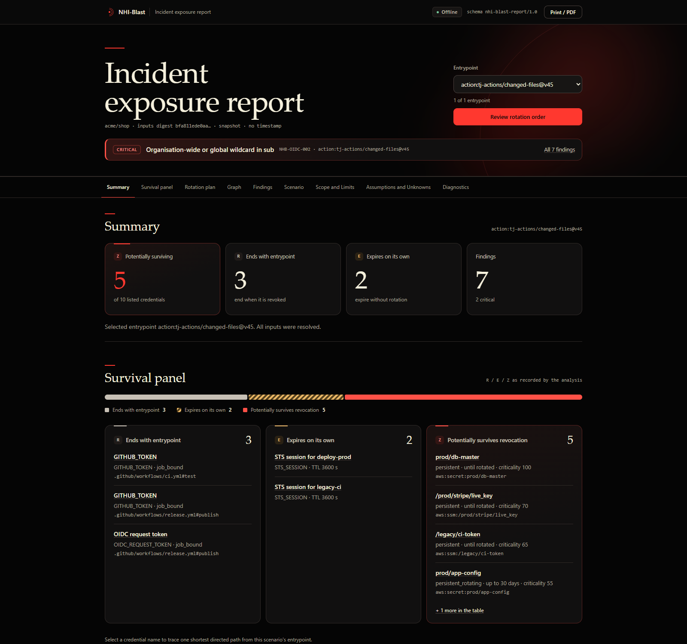

# NHI-Blast

**Offline blast-radius analysis for non-human identity in CI.** GitHub Actions, Terraform and IAM
policy in. Reach, revocation survival and rotation order out — with no execution, no network and no
credential values.

When a CI entrypoint is revoked — a mutable third-party action, a leaked secret, a repository
writer — some credentials end with the job, some expire on their own, and some survive. Working
that out by hand is slow, and live cloud calls are often unavailable during an incident. NHI-Blast
reconstructs the authority those files describe, offline, and answers three questions:

- **Reach** — which AWS roles, credential stores and credentials are potentially reachable?
- **Revocation survival** — which credentials end with the job (**R**), expire on their own (**E**) or survive (**Z**)?
- **Rotation order** — in what order must survivors be rotated so none can re-read a fresh credential?

It reads GitHub Actions workflows, local composites and reusable workflows, Terraform plan/state
JSON with an HCL fallback, and IAM policy JSON. Remote reusable workflows use the caller grant; expressions are never evaluated.

<p align="center"></p>

## Install and quickstart

Requires **Python 3.12+** (tested on 3.12, 3.13 and 3.14). Version 0.2.0 is a source-tree version;
no 0.2.0 artifact is published. The tool needs no cloud credentials and makes no network requests.

```
python -m venv .venv
.venv/bin/python -m pip install ".[hcl]"
```

On Windows use `.venv\Scripts\python.exe`. `[hcl]` adds the optional Terraform HCL fallback and
`-c requirements.lock` pins exact versions; installation needs an index, but runs are offline.

### Windows executable

The standalone Windows x64 build, `nhi-blast-windows-x64.exe`, does not require Python, pip or
administrator rights. No executable is published yet; it will be attached to
[GitHub Releases](https://github.com/DKtech-dev/nhi-blast/releases) after the release process.
Verify a download against its `.sha256` record with
`Get-FileHash .\nhi-blast-windows-x64.exe -Algorithm SHA256`.

```
nhi-blast-windows-x64.exe --help
nhi-blast-windows-x64.exe version
nhi-blast-windows-x64.exe scan . --format html --out nhi-blast-out
```

`--help` lists the commands and `version` reports the tool and schema versions; a scan writes
`nhi-blast-out\report.html`. The one-file executable bundles Python, the optional HCL parser and
the report assets, runs offline and needs no source checkout. It is unsigned, so Windows may show
a reputation-based SmartScreen warning; no code-signing certificate is used.

From the repository root, scan the reference fixture and run its incident scenario:

```
nhi-blast scan tests/fixtures/fx07-incident \
  --simulate-compromise action:tj-actions/changed-files@v45 \
  --format console \
  --format html \
  --fail-on high \
  --out nhi-blast-out
```

`--format` is repeatable. The command prints the console summary and writes `report.html` to
`--out`. It exits `1` because findings meet the `--fail-on high` threshold. Trimmed output:

```text
Survival
  action:tj-actions/changed-files@v45
  R (ends with entrypoint): 3
  E (expires on its own): 2
  Z (survives): 5
    Z prod/db-master (cred:aws:secret:prod/db-master:stored) [declared tfstate.json:77]; depth 0; until rotated; criticality 100
Rotation plan
  action:tj-actions/changed-files@v45 - Rotation
  step 1 generation 0:
    prod/db-master: Rotate the database master password, update the credential store, then terminate existing database sessions so the old password cannot be reused. [declared tfstate.json:77]
Findings
  [CRITICAL] NHB-OIDC-002 NHB-OIDC-002-f3384765: Organisation-wide or global wildcard in sub [declared tfstate.json:43]
  [CRITICAL] NHB-SURV-001 NHB-SURV-001-233ec620: Credentials survive revocation of the entrypoint [declared .github/workflows/release.yml:7]
```

Each credential line names the credential, its graph id, evidence class and source location; the
rotation plan orders survivors after containment. Severity orders findings; it is not a verdict.
JSON and HTML carry the full graph, evidence and assumptions. SARIF carries findings and evidence
but not the full graph; use `nhi-blast export` for JSON or DOT.

## Commands

| Command | Purpose | Artifacts |
| --- | --- | --- |
| `nhi-blast scan PATH` | Parse, audit trust, run scenarios and emit findings | `report.json`, `report.sarif` or `report.html` per `--format` |
| `nhi-blast rank PATH` | Rank mutable third-party actions by potential blast radius | `rank.json` with `--format json` |
| `nhi-blast explain ID --report FILE` | Print the evidence chain for a finding, node or edge | none |
| `nhi-blast export PATH --format json\|dot` | Export the authority graph | `graph.json` or `graph.dot` |
| `nhi-blast schema` | Print the report JSON Schema to stdout | none |
| `nhi-blast version [--data]` | Print tool, schema and data-file versions | none |

Exit codes: `0` success, `1` findings at or above `--fail-on`, `2` usage or input error, `3` partial
results when error diagnostics exist and `--strict` is set, `4` unexpected internal error.

## Selectors

| Selector | Meaning |
| --- | --- |
| `action:OWNER/REPO[/PATH]@REF` | A mutable third-party action at a specific reference, at all use sites. |
| `action-any:OWNER/REPO` | The same action at any reference. |
| `job:RELPATH#JOB_ID` | One job in one workflow file. |
| `workflow:RELPATH` | Every job in a workflow file. |
| `secret:NAME` | A job and the secret reference it holds. |
| `role:ROLE_ID_OR_TF_ADDRESS` | An AWS role identified by graph id, ARN or Terraform address. |
| `repo-write` | A repository writer who can push a branch and edit a workflow. |
| `fork-pr` | A fork pull-request author whose code runs in a pull-request context. |
| `all-mutable-actions` | One scenario per mutable third-party action; also drives `rank`. |

Selectors are repeatable; an invalid selector is a usage error.

## Configuration

`nhi-blast.toml` in the scan root loads automatically; `--config` selects another file inside the
root. Unknown keys are rejected so a typo cannot silently change a result.

```toml
repo_slug = "acme/shop"
default_branch = "main"
aws_account = "111122223333"
aws_region = "us-east-1"
[bindings.roles]
AWS_ROLE_ARN = "arn:aws:iam::111122223333:role/deploy-prod"
[ignore]
rules = ["NHB-GHA-003"]
paths = ["docs/examples/**"]
```

Bindings hold role identifiers, never credential values. `[ignore].paths` matches a finding's
evidence path with shell-style globs; `--strict` reports suppressed findings as diagnostics.

## Security and limitations

- No execution of scanned content and no network access: no Terraform, Git or shell commands, no downloads, no `${{ ... }}` evaluation.
- Reads stay inside the scan root; escaping symlinks and junctions are rejected. Credential values are never stored, printed, logged or embedded.
- Evidence is ordered `DECLARED` > `DERIVED` > `ASSUMED` > `UNKNOWN`; UNKNOWN authority feeds only the `potential` set, never R, E or Z.
- Not modelled: SCPs, permission boundaries, KMS key policies, environment protection, branch rules and live AWS state.

See [known limitations](docs/known-limitations.md) for the full boundary, including unsupported
inputs and what a result does and does not mean. No independent security audit has been performed
or is claimed.

[Architecture](docs/architecture.md) · [specification](docs/SPEC.md) · [rules](docs/rules/README.md) · [assumptions](docs/assumptions.md) · [security audit](docs/security-audit.md) · [release procedure](docs/release.md) · [contributing](CONTRIBUTING.md)

## Licence

Proprietary, all rights reserved. See [LICENSE](LICENSE). No permission is granted to use, copy,
modify or distribute this source tree or future releases without the copyright holder's prior
written permission; viewing or forking on GitHub does not grant it. The published `0.1.0` and
`0.1.1` releases remain under the MIT License. Instrument Serif, Geist and Geist Mono are
embedded under the SIL Open Font License; see [NOTICE](NOTICE).
